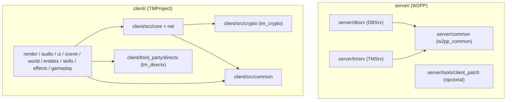

# Arquitetura do Monorepo `derust`

Este documento descreve a organização modular de **W2PP** (`server/`) e **TMProject** (`client/`), estabelecida na **Fase 1** da reestruturação, além das regras de fronteira, travas de ABI e o roteiro da **Fase 2**.

## 1. Visão Geral

O monorepo reúne o servidor e o cliente C++ do *With Your Destiny (WYD)* sob um único sistema de build **CMake** (MSVC Win32/x86, C++17), preservando os históricos completos dos repositórios originais.

> [!IMPORTANT]
> Nesta fase, `server/` e `client/` permanecem **codebases independentes**, cada qual com seu próprio módulo `common/`. Embora compartilhem conceitos de protocolo, estruturas fundamentais divergem em layout binário (por exemplo, `STRUCT_MOB` tem `816` bytes no servidor e `1024` bytes no cliente). A extração de um módulo `shared/protocol` fica reservada para uma etapa futura após a consolidação e auditoria das revisões de pacote.

---

## 2. Mapa de Módulos

### 2.1 Servidor — `server/` (W2PP)

| Diretório | Target CMake | Responsabilidade |
| --- | --- | --- |
| `server/common/` | `w2pp_common` (STATIC) | Tipos base, pacotes, criptografia/socket (`Basedef`, `CPSock`, `ItemEffect`) e trava de layout ABI (`ProtocolLayoutCheck.cpp`). |
| `server/dbsrv/core/` | `DBSrv` (WIN32) | Ponto de entrada (`Server`), leitura de arquivos de dados (`CReadFiles`), `stdafx.h`. |
| `server/dbsrv/persistence/` | `DBSrv` | Persistência de contas/personagens em disco (`CFileDB`) e ranking (`CRanking`). |
| `server/dbsrv/net/` | `DBSrv` | Sessões conectadas de GameServers no DBSrv (`CUser`). |
| `server/dbsrv/resources/` | `DBSrv` | Script de recursos Win32 (`DBSrv.rc`, `resource.h`, `icon1.ico`). |
| `server/tmsrv/core/` | `TMSrv` (WIN32) | Loop principal (`Server`), timers de segundo/minuto (`ProcessSecMinTimer`), leitura de dados (`CReadFiles`), strings (`Language.h`). |
| `server/tmsrv/entities/` | `TMSrv` | Entidades e geradores de mundo (`CMob`, `CItem`, `CUser`, `CNPCGene`). |
| `server/tmsrv/net/` | `TMSrv` | Roteamento cliente/DB (`ProcessClientMessage`, `ProcessDBMessage`) e helpers de envio/consulta (`SendFunc`, `GetFunc`). |
| `server/tmsrv/systems/` | `TMSrv` | Sistemas de mundo/eventos (`MobKilled`, `CCastleZakum`, `CWarTower`, comandos `imple`). |
| `server/tmsrv/handlers/account/` | `TMSrv` | Login, senha numérica, criação/remoção e seleção de personagem (`_MSG_AccountLogin`, `_MSG_CharacterLogin`, etc.). |
| `server/tmsrv/handlers/combat/` | `TMSrv` | Ataque, movimento, ações, distribuição de pontos, barra de skills, PK (`_MSG_Attack`, `_MSG_Action`, etc.). |
| `server/tmsrv/handlers/items/` | `TMSrv` | Uso, compra/venda NPC, drop/pickup, baú, divisão e cápsula (`_MSG_UseItem`, `_MSG_Buy`, `_MSG_Deposit`, etc.). |
| `server/tmsrv/handlers/combine/` | `TMSrv` | Composições de NPCs (`_MSG_CombineItem*`: Agatha, Ailyn, Alquimia, Ehre, Extração, Lindy, Odin, Shany, Tiny). |
| `server/tmsrv/handlers/trade/` | `TMSrv` | Troca direta e loja pessoal (`_MSG_Trade`, `_MSG_TradingItem`, `_MSG_SendAutoTrade`, `_MSG_ReqBuy`, etc.). |
| `server/tmsrv/handlers/social/` | `TMSrv` | Chat, sussurro, grupo, guilda, guerra e duelo (`_MSG_MessageChat`, `_MSG_InviteGuild`, `_MSG_War`, etc.). |
| `server/tmsrv/handlers/world/` | `TMSrv` | Quests, cidade, teleporte, ranking e visibilidade (`_MSG_Quest`, `_MSG_ReqTeleport`, etc.). |
| `server/tmsrv/resources/` | `TMSrv` | Script de recursos Win32 (`TMSrv.rc`, `resource.h`, `icon1.ico`). |
| `server/tools/client_patch/` | `ClientPatch_v7662` (SHARED, opcional) | DLL legada de patch em memória para executável v7662 (`W2PP_BUILD_CLIENT_PATCH=OFF` por padrão). |

### 2.2 Cliente — `client/` (TMProject)

| Diretório | Target CMake | Responsabilidade |
| --- | --- | --- |
| `client/third_party/directx/` | `tm_directx` (INTERFACE) | Headers e `.lib`s do DirectX 9 SDK (anexados após o Windows SDK via `tm_directx.props` para evitar conflito com `basetsd.h`/`multimon.h`). |
| `client/src/core/` | `TMProject` (WIN32) | Ciclo da aplicação (`NewApp`, `TMProject`), PCH (`pch.h`), globais (`TMGlobal`, `TMPaths`), utilitários/log/timer/input/stacktrace. |
| `client/src/common/` | `TMProject` | Protocolo, definições base (`Basedef`, `ItemEffect`, `Structures`, `Enums`, `NewClientB`) e trava de layout ABI (`ProtocolLayoutCheck.cpp`). |
| `client/src/net/` | `TMProject` | Cliente de socket e enfileiramento de pacotes (`CPSock`). |
| `client/src/crypto/` | `tm_crypto` (INTERFACE) | Primitivas criptográficas header-only (`AES`, `Base64`, `desbase64`, `md5`, `MD5Checksum`). |
| `client/src/render/` | `TMProject` | Dispositivo Direct3D9 (`D3DDevice`, `RenderDevice`), texturas, malhas/animações, fontes, câmera e luz. |
| `client/src/audio/` | `TMProject` | Áudio DirectSound e reprodução de vídeo DirectShow (`dsutil`, `DirShow`, `TMVideoWnd`). |
| `client/src/ui/` | `TMProject` | Controles de interface (`SControl`, `SControlContainer`, `SGrid`, `ResourceControl.h`, `UIBinary.h`). |
| `client/src/scene/` | `TMProject` | Árvore de cena, gerenciador de objetos e cenas (`TMScene`, `TMDemoScene`, `TMSelectServerScene`, `TMSelectCharScene`, `TMFieldScene`). |
| `client/src/world/` | `TMProject` | Terreno, água, céu, clima e estruturas estáticas (`TMGround`, `TMSea`, `TMSky`, `TMHouse`, `TMGate`, etc.). |
| `client/src/entities/` | `TMProject` | Personagens, itens no chão, projéteis e criaturas (`TMHuman`, `TMItem`, `TMDrop`, `TMBike`, etc.). |
| `client/src/skills/` | `TMProject` | Efeitos visuais e comportamento das 24 classes `TMSkill*`. |
| `client/src/effects/` | `TMProject` | Partículas, billboards e efeitos visuais `TMEffect*` e `TMFireEffect`. |
| `client/src/gameplay/` | `TMProject` | Missões, composição de itens e tabelas de quest (`Mission`, `MrItemMix`, `Quest.h`). |
| `client/src/resources/` | `TMProject` | Recursos Win32 (`TMProject.rc`, `Resource.h`, ícones e cursores). |
| `client/docs/` | — | Notas históricas do cliente (`Files Name.txt`). |

---

## 3. Dependências e Fronteiras



O script [`tools/check_boundaries.py`](../tools/check_boundaries.py) é executado localmente e no job `check-boundaries` do CI para impedir regressões arquiteturais:
1. Proibido `#include` com barra invertida (`\`) ou caminho relativo com `..` em `server/` e `client/src/`.
2. `server/common/` não pode incluir headers de `dbsrv/`, `tmsrv/` ou `tools/`.
3. `server/dbsrv/` e `server/tmsrv/` não podem incluir headers um do outro.
4. `client/src/crypto/` não pode depender de nenhum outro módulo de `client/src/`.
5. `client/src/common/` não pode incluir headers de camadas superiores (`render/`, `audio/`, `ui/`, `scene/`, `world/`, `entities/`, `skills/`, `effects/`, `gameplay/`).

---

## 4. Build e CI (Windows Win32 / MSVC)

### Pré-requisitos
- Windows 10/11 com Visual Studio 2022 (toolchain C++ Desktop x86) e CMake >= 3.24.
- Arquitetura-alvo obrigatória: **Win32 (`x86`)**, compatível com as bibliotecas estáticas do DirectX 9 em `client/third_party/directx/Lib/`.

### Comandos de Build

```powershell
# Configurar via preset (VS 2022 Win32)
cmake --preset win32-msvc

# Ou com autodetecção da versão do Visual Studio instalada + ClientPatch opcional
cmake -S . -B build/win32-msvc -A Win32 -DW2PP_BUILD_CLIENT_PATCH=ON

# Compilar Debug ou Release
cmake --build build/win32-msvc --config Debug --parallel
cmake --build build/win32-msvc --config Release --parallel
```

Opções CMake disponíveis na raiz:
- `DERUST_BUILD_SERVER` (`ON` por padrão)
- `DERUST_BUILD_CLIENT` (`ON` por padrão)
- `W2PP_BUILD_CLIENT_PATCH` (`OFF` por padrão)

No GitHub Actions ([`.github/workflows/build.yml`](../.github/workflows/build.yml)):
- `check-boundaries` (`ubuntu-latest`): executa `python3 tools/check_boundaries.py`.
- `build-windows` (`windows-latest`, matriz `Debug` e `Release`): compila `w2pp_common`, `DBSrv`, `TMSrv`, `ClientPatch_v7662` e `TMProject`, publicando os binários como artifacts.

---

## 5. Travas de ABI e Protocolo

Os arquivos [`server/common/ProtocolLayoutCheck.cpp`](../server/common/ProtocolLayoutCheck.cpp) e [`client/src/common/ProtocolLayoutCheck.cpp`](../client/src/common/ProtocolLayoutCheck.cpp) validam em tempo de compilação (`static_assert`) o tamanho binário exato em Win32 das estruturas críticas de rede e persistência:

- **Servidor (`w2pp_common`)**: `MSG_STANDARD` (12 B), `STRUCT_ITEM` (8 B), `STRUCT_SCORE` (48 B), `STRUCT_MOB` (816 B), `STRUCT_MOBEXTRA` (536 B), `STRUCT_RANKING` (52 B), `STRUCT_ACCOUNTFILE` (7800 B).
- **Cliente (`TMProject`)**: `MSG_STANDARD` (12 B), `STRUCT_ITEM` (8 B), `STRUCT_SCORE` (48 B), `STRUCT_MOB` (1024 B).

Qualquer refatoração futura que altere alinhamento ou tamanho desses tipos quebra o build imediatamente.

---

## 6. Roteiro da Fase 2 (Quebra de God-Files e Comentários)

Na **Fase 2**, os arquivos monolíticos serão fatiados por coesão (preservando 100% de paridade de comportamento), promovendo subsistemas desacoplados a static libraries CMake com `.clang-format` e testes CTest:

- **Alvos prioritários no cliente**: `TMFieldScene.cpp` (~24,5 mil linhas), `TMHuman.cpp` (~16,3 mil), `SGrid.cpp` (~5,3 mil), `TMGround.cpp` (~4,5 mil), `RenderDevice.cpp` (~3,5 mil), `Basedef.cpp` (~3,4 mil).
- **Alvos prioritários no servidor**: `tmsrv/core/Server.cpp` (~9,4 mil linhas), `common/Basedef.cpp` (~6,8 mil), `_MSG_UseItem.cpp` (~5,7 mil), `_MSG_Quest.cpp` (~2,7 mil), `CFileDB.cpp` (~2,7 mil), `MobKilled.cpp` (~2,5 mil).

### Diretrizes de Comentários e Higiene (Fase 2)
- Idioma: **Português (PT-BR)** nos novos comentários e documentação.
- Interfaces e tipos: comentários **Doxygen (`///`)** em classes, enums, structs de pacote (opcode, direção, campos relevantes) e funções públicas.
- Comentários inline: explicar o *por quê* e regras de domínio do WYD (magic numbers, IDs de itens/skills/quests, fórmulas, bitmasks e efeitos colaterais).
- Código legado:
  - Preservar integralmente os cabeçalhos de licença **GNU GPL v3**.
  - Substituir comentários corrompidos/mojibake (como textos em coreano quebrado) por descrições claras em PT-BR ao revisar cada arquivo.
  - Preservar código comentado suspeito/relevante marcando com `// LEGADO:` em vez de removê-lo sem confirmação.
  - Código novo extraído na Fase 2 deve seguir C++17 limpo e UTF-8.
